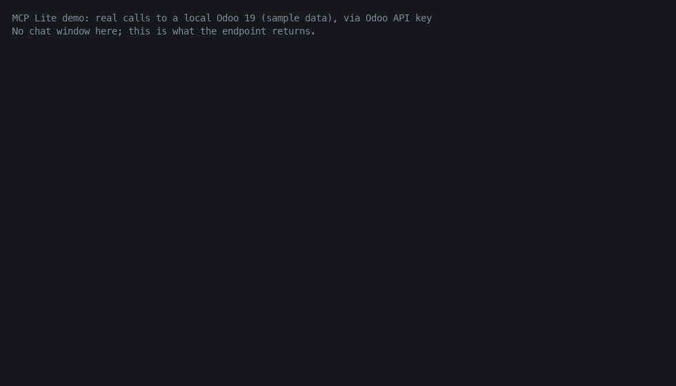

# MCP Lite: a free, read-only MCP server for your ERP

Connect **Claude, ChatGPT, Claude Code or Cursor** to your Odoo database (Community or Enterprise, 17 / 18 / 19; 20 passes the suite on a nightly image, see Tests)
with **one URL**. Sign-in uses OAuth 2.1 built into the module, so there is no proxy, no Node or Python process to run, and nothing to host.

* The assistant works **as the signed-in user**: Odoo access rights, record rules and multi-company rules apply.
* **Read-only**: find models and fields, search, count, total records, report by month, find a record by name. It cannot create, change or delete anything.
* Passwords, tokens, API keys and binary fields are never returned, and cannot be used to filter or group either.
* Per-user **rate limit** and a **Pause all AI access** switch.
* Apache-2.0, no external dependencies.

> Not affiliated with or endorsed by Odoo S.A. "Odoo" is a trademark of Odoo S.A.

## What it looks like



This GIF is a **replay of real calls** to a local Odoo 19 with sample data created by the script (recorded by `scripts/demo.sh`, rendered by
`scripts/render_gif.py`). It is a terminal-style view of requests and responses, **not a screenshot of Claude**: no AI model
is in the loop, and long results are cut for display. The last call shows a hidden-field probe being refused.

With an assistant connected you ask in plain language, for example *"How much did we invoice per month this year, and
which five customers owe us the most?"*, and it picks the tools itself.

## Install (5 minutes)

1. Copy the `mcp_lite` folder into your addons path (or clone this repo and add it to `addons_path`), restart Odoo,
   update the app list, install **MCP Lite**.
2. The address of your ERP must be a public **https** URL for claude.ai and ChatGPT
   (Claude Code and Cursor also work on `http://localhost`).
   * Set `web.base.url` (Settings > Technical > System Parameters), or fill in **Public URL** in MCP Lite > Configuration > Settings.
   * Behind nginx, Caddy or Traefik, start Odoo with `proxy_mode = True` and let the proxy send
     `X-Forwarded-Proto` and `X-Forwarded-Host`.
   * With several databases on one server, set `dbfilter` so the domain opens exactly one database.
3. Administrators can connect straight away. Add other people to the group **MCP Lite: can connect AI assistants**.
4. Copy the **Connector URL** from MCP Lite > Configuration > Settings (it is `https://your-erp/mcp`).

> **Do not install MCP Lite together with the paid AI Connector (`ant_mcp_connector`) on the same database.** Both register the same `/mcp` and OAuth routes, so sign-in will break. If you upgrade to the paid module, uninstall MCP Lite first. (Reported by our own review, not yet tested end to end.)

## Connect your assistant

Replace `https://your-erp` with your public address. Client menus change often; if a label differs, look for
"custom connector" or "remote MCP server".

### Claude Desktop / claude.ai (5 minutes)

1. Settings > Connectors > **Add custom connector**.
2. Name: anything (for example "My ERP"). URL: `https://your-erp/mcp`. Save.
3. Click **Connect**. A browser tab opens on your Odoo login; sign in and click **Allow**.
4. Start a chat, enable the connector from the tools menu, and ask: *"What can you tell me about our open sales orders?"*

claude.ai and the desktop app reach the server from Anthropic's side, so the URL must be public https.

### Claude Code

```bash
claude mcp add --transport http erp https://your-erp/mcp   # localhost works too: http://localhost:8069/mcp
claude                                                      # then type /mcp, pick "erp", Authenticate
```

Without a browser (CI, servers) use an Odoo API key (Preferences > Account Security > New API Key):

```bash
claude mcp add --transport http erp https://your-erp/mcp --header "Authorization: Bearer <api-key>"
```

### Others

| Client | How |
|---|---|
| **ChatGPT** | Settings > Connectors > Advanced > Developer mode, add a custom connector with the URL and OAuth, sign in, **Allow** |
| **Cursor / others** | Streamable HTTP with OAuth, or an Odoo API key as `Authorization: Bearer <key>` |

Not verified by us against the live claude.ai and ChatGPT apps from a public host (see Limits).

## Tools

| Tool | What it does |
|---|---|
| `whoami` | Your user, company, language, timezone |
| `list_models` | Find models by name or label (only those you may read) |
| `get_fields` | Fields of a model: type, label, relation, selection values |
| `search_records` | Search and read records, with domain, fields, order, paging (max 200 per call) |
| `count_records` | Count records for a domain |
| `aggregate_records` | Group and total like a pivot table (sum, avg, min, max, count) |
| `period_report` | Total a measure per day / week / month / quarter / year, optional split by a second field and date range |
| `search_by_name` | Find customers, products, employees by name, like the Odoo search box (returns ids) |
| `suggest_questions` | Example questions for the apps installed here that you may read |

## Safety

Short version; the full model and the honest list of limits is in [SECURITY.md](SECURITY.md).

* Runs with the user's rights. No `sudo()` on business data.
* Hidden: system parameters, API keys, access rules, scheduled actions, 2FA devices, the module's own tokens. Add more models in Settings.
* Hidden fields cannot leak through filters, sorting, grouping, dotted paths or `any` sub-domains (covered by tests).
* **What you let the assistant read is sent to the AI provider.** Connect only users who may share that data, and hide sensitive models (`hr.*`, payroll, bank).
* Prompt injection: text inside a record can steer an assistant. Read-only plus the user's own rights limits the damage to disclosure, not changes.

## Limits

* Read-only on purpose. No approvals, no field policies per group, no audit log with arguments, no reports, no ready-made MCP prompts (`suggest_questions` is a plain tool), no setup self-check.
* The recent-activity list keeps 7 days and stores no arguments or results.
* Tested on Odoo 17, 18 and 19 with the official Docker images (see below). Odoo 20 passes the same suite on the `odoo:20` nightly image (dated 2026-11-02 when tested); nightlies change, so treat it as early support.
* The live claude.ai / ChatGPT connection has not been tested by us end to end; the OAuth and MCP protocol are tested by driving the endpoints directly. Not tested with Odoo.sh, Odoo Online (no custom modules there) or multi-worker setups behind a load balancer.
* Single database per domain.

## Free vs paid

| | **MCP Lite** (this repo, free) | **AI Connector** (paid, [apps.odoo.com](https://apps.odoo.com/apps/modules/19.0/ant_mcp_connector?utm_source=github&utm_medium=readme-table&utm_campaign=mcp-lite)) |
|---|---|---|
| OAuth 2.1 (DCR + PKCE), one URL | yes | yes |
| Read tools: search, count, aggregate, report by period, find by name, fields | yes | yes |
| Sensitive fields hidden everywhere | yes | yes |
| Per-user rate limit, pause switch | yes | yes |
| Hide models (global list) | yes | yes |
| Odoo API key as Bearer | yes | yes |
| Write tools (create, update, post, delete, run action) | **no** | yes |
| **Changes need a person's approval** (diff, approver group) | no | yes |
| **Access policies** per model, user group, hidden fields | no | yes |
| Audit log (90 days, with arguments) and **usage report** | 7-day list, no arguments | yes |
| **Ready-made prompts** (sales, accounting, stock, CRM) | no | yes |
| **Check my setup** (https, proxy, dbfilter, discovery) | no | yes |
| Support | GitHub issues, best effort | email |

If you only want to let an assistant look at your data, the free edition is enough and we mean that.
The paid one is for teams that let the assistant change data and need approvals, rules and a trail.
**The two cannot be installed in the same database** (both answer on `/mcp`); the installer refuses.
To move up, uninstall MCP Lite, install AI Connector, and connect again.

Paid edition: https://apps.odoo.com/apps/modules/19.0/ant_mcp_connector?utm_source=github&utm_medium=readme&utm_campaign=mcp-lite

## Tests

```bash
./scripts/test.sh 19    # also 18, 17 and 20 (nightly image, may break any day); needs Docker; starts a throwaway PostgreSQL and the official odoo image
```

CI runs the same script for 17, 18 and 19, and for 20 as a non-blocking job. On Odoo 20 the test script first converts the access-rights file (`scripts/port20.py`: 20 uses `ir.access.csv`); a proper 20.0 branch would ship that file directly. The suite covers OAuth (PKCE, single-use codes, refresh rotation, revoke), the
tools, access rights, leak attempts through hidden fields, rate limit and the pause switch.

## License

[Apache-2.0](LICENSE). The code of this module is licensed under the Apache License 2.0; you may use, modify and
redistribute it, including in commercial products. Odoo only accepts a fixed list of values in `license`, so the manifest says
`Other OSI approved licence`: it means Apache-2.0. To be straight about it: the module runs inside Odoo, which is LGPL-3,
and Apache-2.0 applies to the code in this repository, not to Odoo itself. Contributions are accepted under Apache-2.0.
The paid AI Connector is separate, proprietary code.

## Maintained by PipeX

MCP Lite is built and maintained by [PipeX](https://www.pipex.pro/?utm_source=github&utm_medium=readme&utm_campaign=mcp-lite), a small company making Odoo modules and mobile apps.
Related open source from the same maintainer: [scenario-browser](https://github.com/chiempt/scenario-browser), browser automation and tests from plain-text scenarios, with its own MCP server so an assistant can validate and run them.

Contributing: [CONTRIBUTING.md](CONTRIBUTING.md). Security: [SECURITY.md](SECURITY.md).
